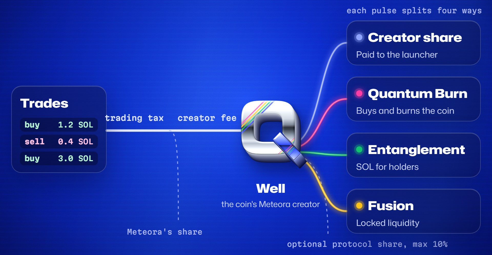

# Welcome to Quant Pad


{% column width="58%" %}
Quant Pad is a launch and trading front end for Meteora on Solana. Its on-chain program, **Quantum Hooks**, decides where each coin's creator fees go: to the launcher, into burns, to holders or into locked liquidity.

Every coin is a real Meteora coin. It trades on Meteora's Dynamic Bonding Curve and, when the curve fills, graduates to a Meteora DAMM v2 pool with its liquidity permanently locked.

<a href="https://quantpad.vercel.app/launch" class="button primary" data-icon="rocket">Launch a coin</a> <a href="https://quantpad.vercel.app" class="button secondary" data-icon="arrow-up-right-from-square">Open Quant Pad</a>


{% column width="42%" %}

**Four hooks, locked at launch**

Creator share, Quantum Burn, Entanglement and Fusion. The launcher sets the split before the coin exists, and nobody can change it afterwards, including Quant Pad.




## Start here

<table data-view="cards">
  <thead>
    <tr>
      <th></th>
      <th></th>
      <th data-hidden data-card-cover data-type="files"></th>
      <th data-hidden data-card-target data-type="content-ref"></th>
    </tr>
  </thead>
  <tbody>
    <tr>
      <td><i class="fa-rocket">:rocket:</i> <strong>Launch a coin</strong></td>
      <td>Create a Meteora coin with or without Quantum Hooks, in one signing flow.</td>
      <td><a href=".gitbook/assets/card-launch.jpg">card-launch.jpg</a></td>
      <td><a href="getting-started/launching-a-coin.md">launching-a-coin.md</a></td>
    </tr>
    <tr>
      <td><i class="fa-arrow-right-arrow-left">:arrow-right-arrow-left:</i> <strong>Trade</strong></td>
      <td>Buy and sell any Meteora bonding-curve coin with SOL.</td>
      <td><a href=".gitbook/assets/card-trade.jpg">card-trade.jpg</a></td>
      <td><a href="getting-started/trading.md">trading.md</a></td>
    </tr>
    <tr>
      <td><i class="fa-atom">:atom:</i> <strong>Quantum Hooks</strong></td>
      <td>Route creator fees into burns, holder rewards and locked liquidity.</td>
      <td><a href=".gitbook/assets/card-hooks.jpg">card-hooks.jpg</a></td>
      <td><a href="quantum-hooks/overview.md">overview.md</a></td>
    </tr>
    <tr>
      <td><i class="fa-receipt">:receipt:</i> <strong>Fees</strong></td>
      <td>Trading taxes, platform fees and what a launch costs.</td>
      <td><a href=".gitbook/assets/card-fees.jpg">card-fees.jpg</a></td>
      <td><a href="reference/fees.md">fees.md</a></td>
    </tr>
  </tbody>
</table>

## Where the fees go

Every trade pays the coin's trading tax. Meteora keeps its protocol share, and the rest is the creator fee. For a Quantum coin, the creator is the coin's own well, and every pulse splits the well's fees across the four hooks.

<figure><figcaption></figcaption></figure>

<a href="quantum-hooks/overview.md" class="button secondary" data-icon="atom">How Quantum Hooks work</a>

## Ask the docs

<button type="button" class="button primary" data-action="ask" data-icon="gitbook-assistant">Ask the Quant Pad docs</button> <button type="button" class="button secondary" data-action="ask" data-query="How do Quantum Hooks split a coin's creator fees?" data-icon="atom">How hooks split fees</button> <button type="button" class="button secondary" data-action="ask" data-query="What does it cost to launch a coin on Quant Pad?" data-icon="receipt">Launch cost</button> <button type="button" class="button secondary" data-action="ask" data-query="Can a coin's hook split be changed after launch?" data-icon="lock">Can the split change?</button>


Memecoins are extremely volatile and most lose all value. The Quantum Hooks program has not yet been independently audited. Read [Safety](reference/safety.md) before you launch or trade.


## Community

<table data-view="cards">
  <thead>
    <tr>
      <th></th>
      <th></th>
      <th data-hidden data-card-target data-type="content-ref"></th>
    </tr>
  </thead>
  <tbody>
    <tr>
      <td><i class="fa-x-twitter">:x-twitter:</i> <strong>X</strong></td>
      <td>Launch news and updates from @quantpadhook.</td>
      <td><a href="https://x.com/quantpadhook">https://x.com/quantpadhook</a></td>
    </tr>
    <tr>
      <td><i class="fa-telegram">:telegram:</i> <strong>Telegram</strong></td>
      <td>Talk to the team and other launchers.</td>
      <td><a href="https://t.me/+3wl4eNhZcaNkNmM5">https://t.me/+3wl4eNhZcaNkNmM5</a></td>
    </tr>
  </tbody>
</table>
