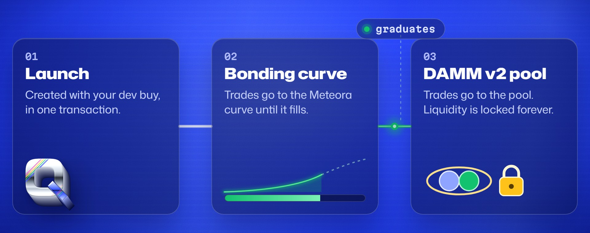

# Trading

Buy with SOL and sell for SOL from any coin page.

## Where your trade goes

* **Before graduation**, trades go to the coin's Meteora bonding curve.
* **After graduation**, trades go to the coin's Meteora DAMM v2 pool.

<figure><figcaption></figcaption></figure>

## Slippage

Your slippage limit is enforced on-chain. If the price moves past your limit, the trade fails instead of filling at a worse price.

## Finding a coin

You can open any Meteora bonding-curve coin, not only coins launched on Quant Pad. Paste its mint address in the search box.

## Fees on trades

Each coin has a trading tax, shown on its coin page. Any Quant Pad platform fee is shown before you sign, as a separate transfer. See [Fees](../reference/fees.md) for details.
