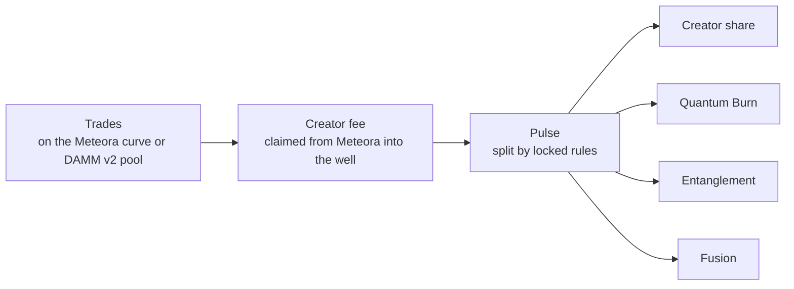

# How Quantum Hooks work

Quantum Hooks work on the one stream every coin has: its creator fees. A Quant Pad coin's Meteora creator is the coin's own **well**, a program-controlled address, and the hooks decide where every lamport goes.

## Key terms

* **Well:** a program-controlled address unique to each Quantum coin. It is the coin's Meteora creator, so creator fees accumulate for it.
* **Pulse:** collects the well's creator fees and splits them by the allocation fixed at launch.
* **Keeper:** Quant Pad's automated service. It runs pulses, burns and Fusion deposits, and posts Entanglement epochs. If the keeper stops, anyone can run pulses, burns and Fusion after a grace period.

## Protocol share

Quantum Hooks can take a protocol share of each fee pulse before it is split. The share is capped at 10% on-chain, and any share is shown before you sign.

## Learn more

* [Fee modules](fee-modules.md): where each slice of a pulse goes
* [Launch extras](launch-extras.md): Superposition and Time Dilation
* [Guarantees and risks](guarantees-and-risks.md): what the program enforces, and what it can't

<a href="https://quantpad.vercel.app/launch" class="button primary">Launch with Quantum Hooks</a>
